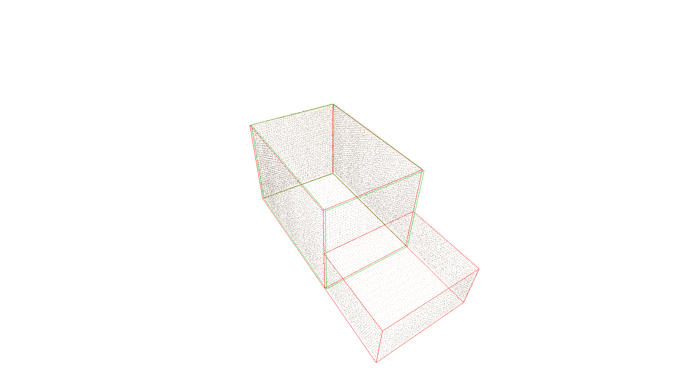
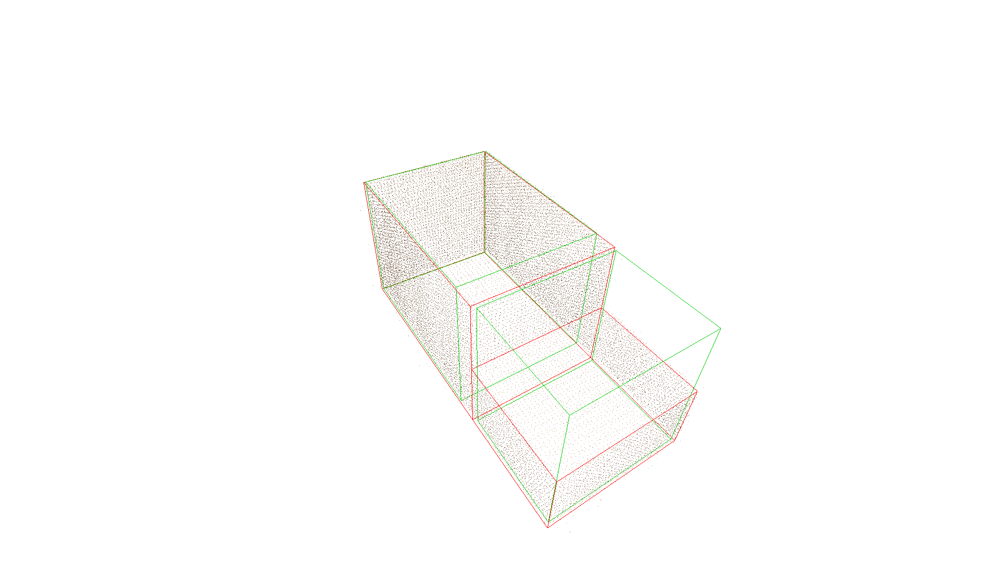
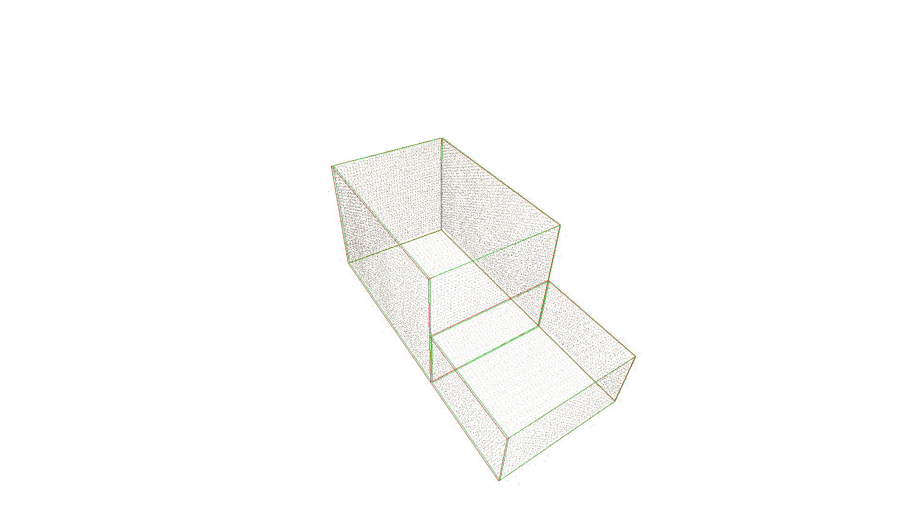
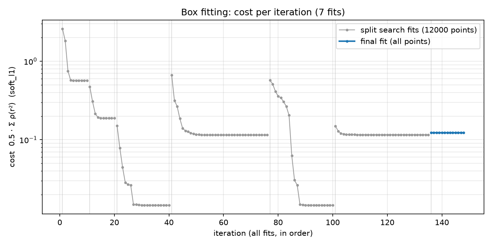
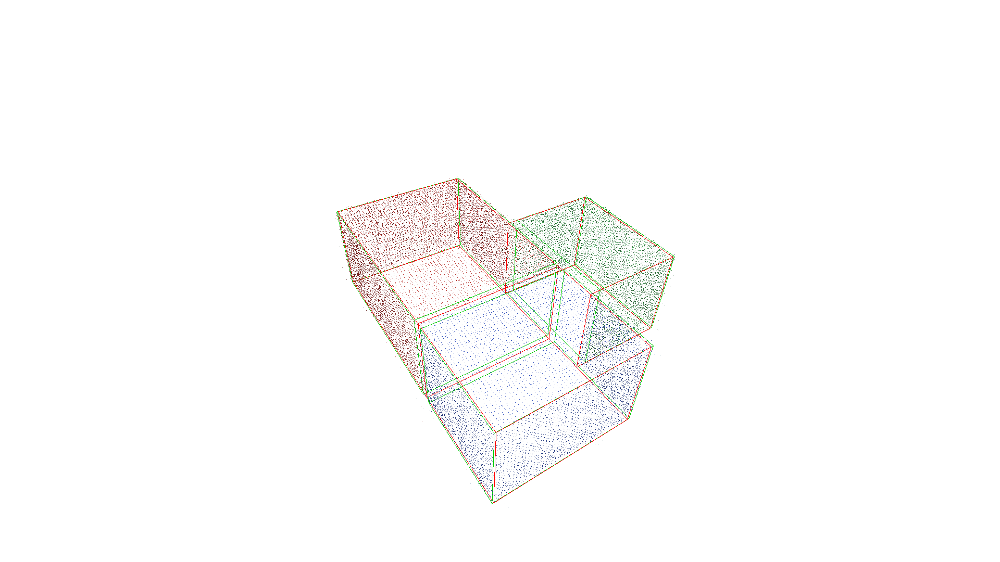
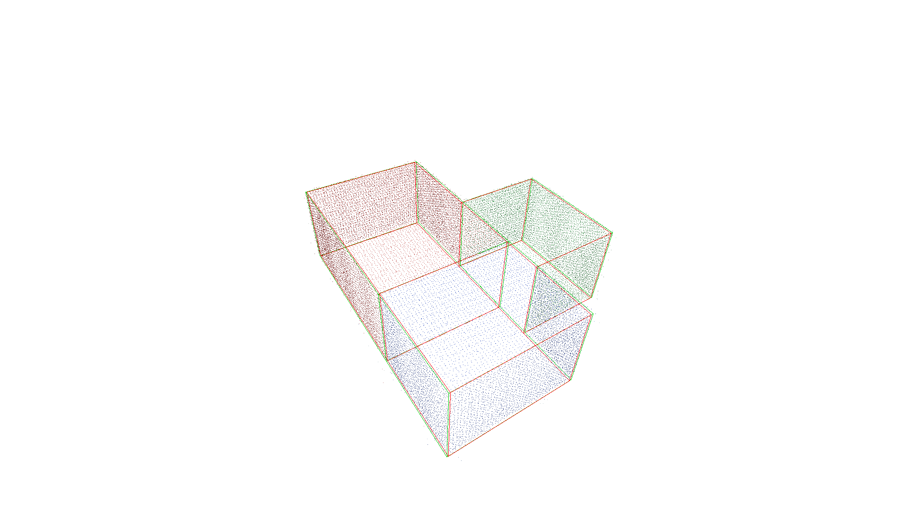
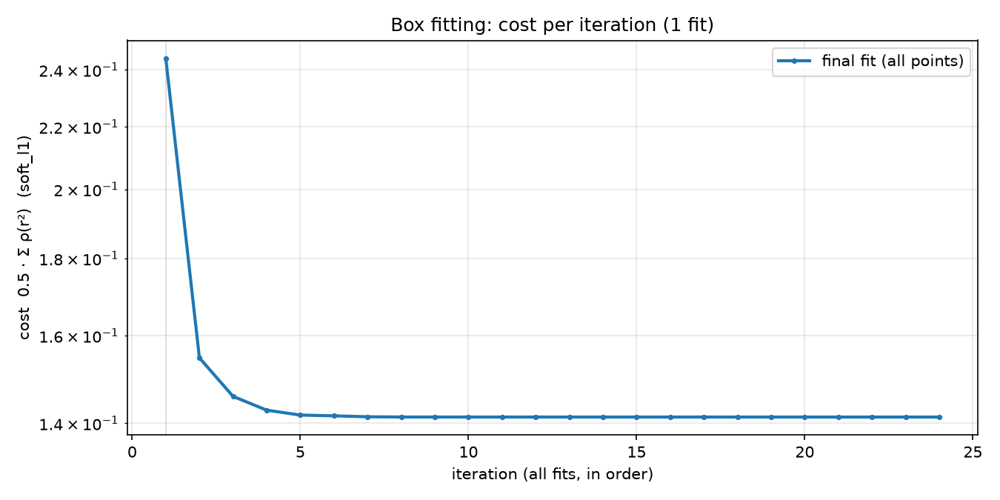

# How our pipeline works

What `gw/main.py` does, step by step, with the numbers we measured. The assignment is in
[`SAVI_26-27/Trabalho1/readme.md`](../../SAVI_26-27/Trabalho1/readme.md); the theory behind each step is
in the [learning guide](learning_guide.md). The same page is on our GitHub Pages site
(`docs/how_it_works.html`).

```
8 RGB-D point clouds
  │
  ├─ Part 1   registration.py   every camera aligned with camera 000
  ├─ Extra    photometry.py     every image's colours corrected to image 000
  ├─ Part 2   segmentation.py   table, objects on it, split by colour when needed
  └─ Part 3   bounding_box.py   base method: one box per object
              optimization.py   main method: least-squares fit of all the boxes
                                 → result.json
```

## Commands

```bash
cd gw
./main.py --scene scenes/level_4 --num_boxes 3                     # normal run, writes result.json
./main.py --scene scenes/level_4 --num_boxes 3 --show              # all the 3D windows
./main.py --scene scenes/level_3_heights --num_boxes 2 --show_optimization   # boxes moving + cost plot
./main.py --scene scenes/level_1 --num_boxes 1 --bbox open3d       # base method as in the assignment
./main.py --scene scenes/level_1 --num_boxes 1 --bbox open3d_minimal
./main.py --scene scenes/level_4_exposure --num_boxes 3 --no_photometric   # without the colour correction
```

---

## Part 1 – Registration

Every point cloud is in the frame of the camera that took it. For each camera $i$ we look for
$T_{\text{camera0},\,i}$:

1. **Initial estimate:** FPFH features + RANSAC between camera $i$ and its neighbour $i-1$
   (they overlap the most), chained: $T_{0,i} = T_{0,i-1}\,T_{i-1,i}$. RANSAC is run 5 times and
   every different answer is kept as a candidate. The **last camera is also matched against camera
   000**, because the ring of cameras closes there.
2. **Refinement:** point-to-plane ICP, coarse (4 cm) then fine (1 cm), against *all* the clouds already
   aligned. The candidate with the best ICP fitness wins.
3. **Refinement passes (3):** every camera, **camera 000 included**, is aligned again against all the
   others; then every pose is re-expressed in the new camera-000 frame, $T_i \leftarrow T_0^{-1} T_i$.

Why the two fixes: in two scenes RANSAC 007 → 006 only gave wrong answers (~1 m slides), while
007 → 000 was right every time; and when camera 000 never moved, cameras 1–7 agreed with each other
but the whole group stayed ~0.4° rotated with respect to 000 (the error grew with the distance to
camera 000).

| Scene | Before the fixes | Now |
|---|---|---|
| level_1 | 5.9 mm / 0.26° | 3.1 mm / 0.10° |
| level_2 | 7.1 mm / 0.40° | 3.0 mm / 0.16° |
| level_3_heights | 100 mm (camera 007 lost) | 3.6 mm / 0.13° |
| level_3_stacked | 120 mm (camera 007 lost) | 4.4 mm / 0.19° |
| level_4 | 8.3 mm / 0.36° | 2.7 mm / 0.08° |

(mean over the cameras; full tables in [`gw/results/`](../results/README.md))

## Extra – Photometric correction

With automatic exposure (simulator option `--exposure_changes`) every image has its own gain and bias,
the same for R, G and B: $c_i = s_i\,c + b_i$. The same box looks brighter in one image and darker in
another, so the colours of the aggregated cloud disagree.

We estimate every image **relative to image 000**: $c_i = s_{i0}\,c_0 + b_{i0}$, with
$s_{i0} = s_i / s_0$ and $b_{i0} = b_i - s_{i0}\,b_0$, and correct it with
$\hat c_i = (c_i - b_{i0}) / s_{i0}$.

- **Data:** after the registration, two points of different cameras closer than 5 mm are the same
  surface (10 mm voxels, up to 3000 pairs per camera pair).
- **Residual** (one per pair and channel), image $j$ mapped into image $i$ and compared in image $i$'s
  raw colours: $\;c_i - \big[\tfrac{s_{i0}}{s_{j0}}(c_j - b_{j0}) + b_{i0}\big]$.
  Comparing the corrected colours instead, $(c_i - b_i)/s_i - (c_j - b_j)/s_j$, rewards a bigger $s$
  (dividing by $s$ shrinks every difference): it gave $s \approx 1.03$ on a scene with no exposure
  changes at all.
- **Image 000 fixed** at $s = 1, b = 0$: with every image free the solution is not unique (Parte 06, ex. 2).
- Colours near 0 or 1 (clipped by the camera) are left out; `soft_l1` for the pairs on colour edges.

It runs by default (about 1.5 s); on scenes without exposure changes it estimates $s \approx 1$,
$b \approx 0$ and changes nothing.

level_4 with exposure changes, full pipeline:

| image | s (ours) | s (true) | b (ours) | b (true) |
|---|---|---|---|---|
| 001 | 1.025 | 1.027 | +0.017 | +0.016 |
| 002 | 0.779 | 0.779 | +0.009 | +0.007 |
| 003 | 0.933 | 0.935 | −0.022 | −0.024 |
| 004 | 0.917 | 0.921 | −0.081 | −0.084 |
| 005 | 0.979 | 0.983 | −0.043 | −0.047 |
| 006 | 0.968 | 0.973 | −0.045 | −0.049 |
| 007 | 1.129 | 1.179 | +0.061 | +0.044 |

Image 007 only overlaps images 006 and 000 on surfaces with a narrow range of colours; there a bigger
$s$ with a smaller $b$ predicts almost the same colours (the two lines cross at $c \approx 0.33$), so
$s$ and $b$ cannot be separated well, although the corrected colours are right.

| level_4 with exposure changes | Points with no clear colour | Segmentation recall (3 boxes) | Optimization IoU |
|---|---|---|---|
| without correction | 16.0 % | 0.70 / 0.91 / 0.80 | 0.953 |
| with correction | 2.9 % | 0.92 / 0.91 / 0.91 | 0.957 |

The IoU hardly changes because the colour split uses chromaticity (which ignores the gain) and the
optimization weighs colour weakly; the correction mostly gives the segmentation its points back.

## Part 2 – Segmentation

1. **Table plane:** RANSAC (`segment_plane`) finds several planes; the table is the horizontal one,
   big enough not to be a box top, that the optical axis of camera 000 hits first (the floor is behind
   it). The plane is refitted a few times by least squares (SVD) on the biggest cluster of its inliers.
2. **Table frame:** origin at the centre of the table top, z up, x along the long side (`cv2.minAreaRect`).
3. **Crop:** points more than 8 mm above the table and inside its limits.
4. **Euclidean clustering:** DBSCAN (`cluster_dbscan`, eps 1.5 cm).
5. **Colour split (level 4):** touching boxes of different colours form one cluster. In chromaticity
   $(r, g) = (R, G)/(R+G+B)$, which removes the brightness (top and sides of a box are lit differently),
   each colour is a peak of the 2D histogram. Real colours hold 2–9 % of the cluster's points in their
   peak bin, the mixed colours at the seams 0.01 %, so a 0.3 % threshold separates them. Every point
   takes the nearest peak (if closer than 0.06), and each colour group is clustered again. A cluster
   with one colour is left as it is, so levels 1–3 do not change.

## Part 3 – Base method: bounding boxes

The assignment asks for a base method to compare against: "how far we get without the optimization".
We have two, chosen with `--bbox`.

### The assignment's: Open3D oriented bounding box (`--bbox open3d`, `--bbox open3d_minimal`)

1. Statistical outlier removal (20 neighbours, 2 σ), to be fair to the method.
2. In the table frame, `get_oriented_bounding_box()` (axes from PCA of the convex hull) or
   `get_minimal_oriented_bounding_box()` (the orientation with the smallest volume).
3. Conversion to our convention (z up): the OBB axis closest to the table normal becomes the height,
   the other two the length and width, and the yaw is the direction of the length axis seen from above.
   If the box rests on the table, its base is moved down to the table (the segmentation removed the
   first 8 mm).

It **encloses** the points, so each face is set by the most extreme points: one flying pixel that
survives the outlier removal grows the box. With PCA the axes also follow how the points are spread,
not the faces of the box, so the box comes out rotated and too big; and if the OBB is tilted the
conversion to a z-up box is not exact.

### Ours: the box from its planes (`--bbox planes`, the default)

All in the table frame, with the normal of every point (radius 1 cm):

| Parameter | How | Points used |
|---|---|---|
| top | peak of the histogram of the heights, in the top 3 cm, then the median within 4 mm of it | points with a vertical normal ($\lvert n_z\rvert > 0.95$) |
| yaw | the walls' normals are at yaw + k·90°, so with angles $\theta$: $\text{yaw} = \tfrac14 \arg\sum e^{4i\theta}$; a second pass drops normals more than 10° off | points with a horizontal normal ($\lvert n_z\rvert < 0.3$), away from the top and bottom edges |
| each of the 4 walls | median position, along the wall's normal, of the points facing that way on that side; if fewer than 30, the 1st / 99th percentile | points with $\lvert n \cdot \text{axis}\rvert > 0.8$ |
| bottom | the table (0) if lower than 2 cm, otherwise the 1st percentile | all |

Each face comes from the **median of a whole face**, not from extreme points, so noise and flying
pixels barely move it. It is very close to a geometric fit already, and it is the **initial estimate of
the optimization** (whatever `--bbox` says).

### Comparison (3D IoU, same segmentation, camera poses of `gw/results/registration_fixes`)

| Scene | Open3D OBB | Open3D minimal OBB | Ours (planes) | Optimization |
|---|---|---|---|---|
| level_1 | 0.707 | 0.902 | 0.977 | 0.977 |
| level_2 | 0.603 | 0.886 | 0.985 | 0.984 |
| level_3_aligned | 0.271 | 0.312 | 0.336 | 0.632 |
| level_3_heights | 0.278 | 0.303 | 0.484 | 0.976 |
| level_3_rotated | 0.190 | 0.201 | 0.279 | 0.977 |
| level_3_widths | 0.224 | 0.284 | 0.309 | 0.967 |
| level_3_stacked | 0.601 | 0.898 | 0.974 | 0.972 |
| level_4 | 0.498 | 0.894 | 0.913 | 0.966 |

- Against the assignment's box, the optimization gains 0.07–0.38 IoU on levels 1–2.
- Against ours it gains nothing on levels 1–2: there one box per cluster and clean faces leave the
  optimization nothing to correct.
- On level 3 every bounding box fails: there is one cluster for two boxes. Only the optimization
  splits it.
- level_3_aligned (same colour, same width and height, flush) is impossible: the seam between the two
  boxes cannot be seen, so any split explains the points equally well.

## Part 3 – Main method: least-squares fit

Every box has 7 parameters in the table frame, $(x, y, z, \text{yaw}, L, W, H)$; all the boxes are fitted
together with `scipy.optimize.least_squares` (`soft_l1`, scale 1 cm). Residuals:

1. **Point → box:** every point's distance to the surface of the box that explains it best. The
   association is recomputed in every evaluation (no outer loop): the closest box, or with colour (below)
   the box that best explains position *and* colour.
2. **Face support (box → points):** 6×6 samples on every face; each one should have a point near it,
   unless the face cannot be seen (on the table, or touching / covered by another box). Without it a box
   can grow over empty space at no cost: on level_4 three thin slabs covering the whole footprint won
   (IoU 0.142); with it, 0.683 without colour.
3. **Overlap:** the penetration depth between every two boxes (separating axis theorem).
4. **Size:** a small pull on $L + W$.
5. **Colour (level 4):** a point pays $\tfrac{\sigma_g}{\sigma_c}\,\lVert c - c_k\rVert$ for a colour
   different from its box's, with $\sigma_g = 2$ mm and $\sigma_c = 0.15$: a full colour mismatch costs
   like a 6 mm distance, enough to place the seam between two flush boxes, too little to pull a point off
   the surface it is on. With $\sigma_c = 0.015$ (the colour noise), 20–30 % wrong colours dropped the IoU
   to 0.63; with 0.15 it stays at 0.966.

**Split search:** when a cluster has fewer boxes than `--num_boxes`, boxes are added one at a time;
each time a few candidates are tried (a new box on the unexplained points, trimming the box that covers
them, splitting a box in two, horizontally or in height) and the one with the lowest cost wins.

**Level 4 approaches** (level_4, saved poses):

| | Wrong colours 0 % | 10 % | 20 % | 30 % |
|---|---|---|---|---|
| 1. split by colour → bounding box | 0.913 | 0.919 | 0.819 | 0.463 |
| 2. split by colour → fit each box (fixed association) | 0.966 | 0.963 | 0.640 | 0.243 |
| 3. colour in the objective | 0.966 | 0.966 | 0.642 | 0.462 |
| geometry only (no colour in the objective) | 0.959 | 0.959 | 0.561 | 0.253 |

With 20–30 % wrong colours what fails is the initial estimate (the colour groups); started from
clean boxes, approach 3 stays at 0.965.

### The boxes during the optimization

`--show_optimization` (or `--show`) draws the boxes after every iteration (`least_squares`' `callback`):
green = current, red = true. After the window is closed it plots the cost against the iteration and
saves `optimization_cost.png` next to `result.json`.

| Start | Split search | Final |
|---|---|---|
|  |  |  |



level_3_heights: 7 fits. The candidates that split the cluster in the right place drop to ~0.015, the
others stop at ~0.11; the final fit refines the winner with all the points (its cost is higher only
because it has ~9 times more points).

| level_4 start | level_4 final |
|---|---|
|  |  |


